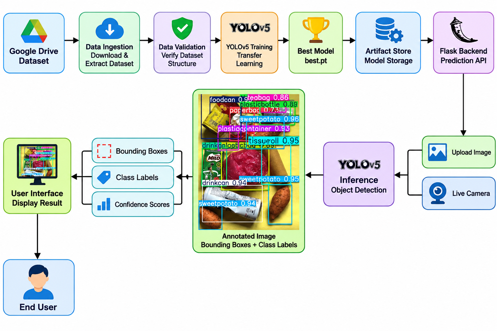
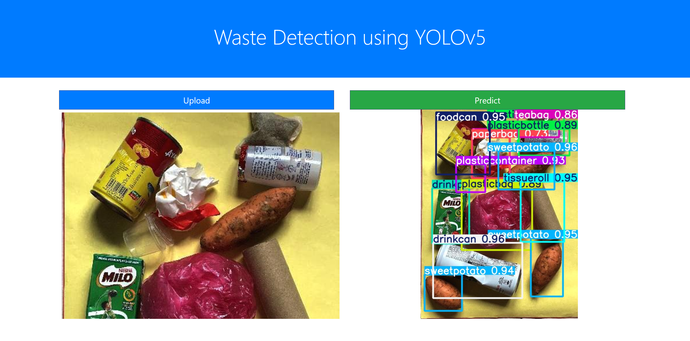

<div align="justify">

# Real-time-Waste-Detection

# Project Demo


## ♻️ Real-Time Waste Detection

## Overview

Waste management is a critical environmental challenge worldwide. Improper waste segregation leads to increased landfill accumulation, reduced recycling efficiency, environmental pollution, and higher waste processing costs. Traditional waste sorting methods are often manual, time-consuming, and prone to human error. This project presents a Real-Time Waste Detection System using YOLOv5, a deep learning-based object detection framework capable of identifying multiple waste objects within a single image. The system automatically detects waste items, localizes them using bounding boxes, classifies them into their respective categories, and provides confidence scores for each prediction.

The solution is built as an end-to-end Machine Learning pipeline comprising data acquisition, validation, model training, artifact generation, inference, and deployment components. A Flask web application allows users to upload images and obtain real-time waste detection results through an interactive browser interface. The project is designed with MLOps principles in mind, utilizing modular components, centralized configuration management, logging, exception handling, and artifact tracking to ensure scalability, maintainability, and future cloud deployment readiness.

## Problem Statement

Efficient waste segregation plays a crucial role in recycling operations and sustainable waste management. However, many waste processing facilities still rely heavily on human labor to identify and separate waste items. This manual process introduces several challenges:

- High operational costs.
- Human classification errors.
- Slow processing speed.
- Poor scalability.
- Inconsistent sorting quality.
- Increased exposure to hazardous waste materials.

As urban populations continue to grow, the volume of generated waste increases significantly. Smart waste management systems require automated solutions capable of identifying recyclable and non-recyclable materials quickly and accurately. The objective of this project is to develop an automated computer vision system capable of detecting and classifying multiple waste objects within images while providing localization information through bounding boxes. The system must support real-time inference and future deployment in production environments.

## Proposed Solution

To address the waste segregation challenge, this project implements a YOLOv5-based object detection framework trained on a custom waste dataset. The model learns visual patterns associated with different waste categories and can identify multiple objects simultaneously from a single image.

The trained model is integrated with a Flask-based web application that allows users to upload images and instantly receive predictions. Each detected object is highlighted with a bounding box, class label, and confidence score, providing an intuitive representation of model predictions.

## Project Objectives

The primary objectives of this project include:

- Automating waste object detection using deep learning.
- Detecting multiple waste objects in a single image.
- Localizing waste items using bounding boxes.
- Providing confidence scores for predictions.
- Building a reusable training pipeline.
- Developing a web application for inference.
- Preparing the application for future cloud deployment using AWS services.

## Technology Stack
### Programming Language
- Python
### Deep Learning Framework
- PyTorch
- YOLOv5
### Computer Vision
- OpenCV
- Pillow
### Backend Framework
- Flask
- Flask-CORS
### Data Handling
- NumPy
- Pandas
- YAML
## Dataset Management
- Google Drive
- gdown
### Model Training
- YOLOv5s Pretrained Model
- Transfer Learning
### Deployment
- Docker
- AWS IAM
- Amazon ECR
- Amazon EC2


# Workflow


# Web-App detection


# Dataset

The project uses a custom object detection dataset stored on Google Drive. The dataset contains images of different waste categories along with annotation files required by YOLOv5.

The dataset is organized according to the YOLO format and includes:

- Training images
- Validation images
- Label files
- Dataset configuration file

The dataset configuration file contains class information and location references used during training.

# Project Workflow

The project follows an end-to-end machine learning lifecycle consisting of three major phases:

- Training Pipeline
- Model Management
- Prediction Pipeline
- Training Pipeline

The training pipeline is responsible for building the object detection model from raw data.

# Data Ingestion

The first stage of the pipeline downloads the dataset from Google Drive and stores it inside the project's artifact directory. Instead of manually downloading data each time training is required, the ingestion component automatically fetches the dataset using the configured dataset URL. The downloaded ZIP file is then extracted into a feature store directory where it becomes available for later stages. This automated process ensures that model training is reproducible and independent of manual dataset management.

# Data Validation

After the dataset is extracted, a validation process verifies that the dataset structure is correct. The validation component checks whether all required directories and files are present. This includes training data, validation data, and dataset configuration files. If any essential component is missing, the pipeline is stopped immediately. Executing validation before training prevents wasted computational resources and ensures model quality. The validation outcome is saved in an artifact file that records whether the dataset passed all quality checks.

# Model Preparation

Once validation succeeds, the training pipeline begins preparing the YOLOv5 model. The dataset configuration file is examined to determine the total number of classes that must be detected. Since YOLOv5 requires the output layer dimensions to match the dataset classes, a custom configuration is created automatically. This dynamic configuration generation allows the framework to adapt easily to future datasets without requiring manual modifications to the model architecture.

# Model Training

The training phase utilizes YOLOv5s as the base architecture. The model initially loads pretrained weights that already contain generalized visual features learned from large object detection datasets. Transfer learning significantly reduces training time and improves convergence.

During training, the model learns:

- Object location prediction
- Bounding box regression
- Object classification
- Confidence estimation

Each training epoch improves the model’s ability to distinguish between different waste categories and accurately locate them within images.

# Model Selection

Throughout training, YOLOv5 automatically evaluates model performance on validation data. The best-performing model is saved as a weight file. Rather than using the final epoch model, the pipeline selects the checkpoint that achieved the best validation performance.
This approach ensures that deployment utilizes the most accurate available model.

# Artifact Storage

After training completes, the selected model is stored inside the artifact management directory. The artifact directory acts as a central repository for all generated outputs, including datasets, validation reports, and trained models. Using artifacts provides better traceability and organization for future experimentation and deployment.

# Prediction Pipeline

The prediction pipeline enables users to perform real-time waste detection using the trained model.

## Image Upload

The user uploads an image through the Flask web interface. The frontend converts the image into Base64 format and sends it to the backend prediction endpoint for processing. This mechanism enables easy communication between the browser and server without requiring traditional file transfers.

## Image Processing

On the server side, the incoming Base64 image is decoded and temporarily stored. The system prepares the image in a suitable format for YOLOv5 inference while ensuring compatibility with the detection model. Any previous prediction outputs are removed before inference begins to guarantee clean and consistent results.

## Object Detection

The trained YOLOv5 model analyzes the image and processes all visible regions simultaneously. Unlike traditional image classification systems that return a single label, YOLOv5 performs object detection, meaning it identifies:

- What objects are present
- Where objects are located
- How confident the model is

A single image may contain numerous waste objects, all of which can be detected during one inference pass.

## Localization and Classification

For every detected object, the model generates:

- Bounding box coordinates
- Object category
- Confidence score

The bounding box precisely marks the object location, while the confidence score indicates prediction certainty. This combination of localization and classification makes the model highly suitable for automated waste sorting applications.

## Output Generation

After detection is complete, YOLOv5 produces an annotated image containing all prediction results. The Flask application retrieves this image and converts it back into Base64 format before returning it to the user interface.

The user receives an image that clearly displays:

- Detected objects
- Bounding boxes
- Class names
- Confidence scores


# Experimental Results

The developed model successfully identifies multiple waste objects within a single image. As demonstrated in the application output, the model detects various waste categories such as:

- Food cans
- Drink cans
- Plastic bottles
- Plastic containers
- Plastic bags
- Paper bags
- Tea bags
- Tissue rolls
- Organic waste items

Each detected object is localized using bounding boxes and labeled with corresponding confidence values, demonstrating the effectiveness of YOLOv5 for waste detection applications.

The results highlight the model's capability to perform multi-object detection in complex scenes where several waste materials appear simultaneously.

# Web Application

The Flask web application provides a simple and intuitive interface for users.

The system enables users to:

- Upload images
- Trigger predictions
- View annotated results
- Perform waste detection in real time

The application also supports live camera detection, allowing waste objects to be detected directly from a webcam feed.

# MLOps Features

The project follows several important MLOps practices:

## Modular Architecture

Each pipeline stage is separated into independent components, making the system easier to maintain and extend.

## Artifact Management

All outputs are stored as artifacts for improved traceability and reproducibility.

## Centralized Configuration

Configuration parameters are maintained separately from implementation logic.

## Logging

Timestamp-based logging captures pipeline activity for monitoring and debugging.

## Exception Handling

Custom exception classes provide robust error reporting throughout the pipeline.

## Reproducibility

The training pipeline can be executed repeatedly with consistent results.

## AWS Deployment

The next phase of the project focuses on cloud deployment.

The application will be containerized using Docker and deployed using Amazon Web Services.

The planned deployment architecture consists of:

GitHub Repository
        │
        ▼
GitHub Actions
        │
        ▼
Docker Image Build
        │
        ▼
Amazon ECR
        │
        ▼
Amazon EC2
        │
        ▼
Flask Application
        │
        ▼
YOLOv5 Inference Service


AWS services that will be utilized include:

- IAM for secure access control
- ECR for container image storage
- EC2 for application hosting
- Docker for containerized deployment

This architecture will enable scalable and production-ready deployment of the waste detection system.

# Conclusion

This project successfully demonstrates the application of deep learning and computer vision techniques to automated waste management. By leveraging YOLOv5 object detection, the system can accurately identify and localize multiple waste objects in real time. The incorporation of an end-to-end machine learning pipeline, artifact management, logging framework, Flask-based inference service, and deployment-ready architecture transforms the project from a simple object detection model into a complete MLOps-oriented solution.

The developed system has significant potential for integration into smart recycling facilities, waste segregation systems, environmental monitoring platforms, and smart city infrastructures, contributing toward more efficient and sustainable waste management practices.


# Workflows

1. constants
2. entity
3. components
4. pipelines
5. app.py


# How to run?
## STEPS:

## Clone the repository
```bash
https://github.com/entbappy/End-to-end-waste-detection
```

## STEP 01- Create a conda environment after opening the repository

```bash
conda create -n waste python=3.7 -y

conda activate waste
```

## STEP 02- install the requirements
```bash
pip install -r requirements.txt
```
# Finally run the following command
```bash
python app.py
```
Now,
```text
open up you local host and port
```

# AWS-CICD-Deployment-with-Github-Actions
## 1. Login to AWS console.
## 2. Create IAM user for deployment

```bash
#with specific access

1. EC2 access : It is virtual machine

2. ECR: Elastic Container registry to save your docker image in aws


#Description: About the deployment

1. Build docker image of the source code

2. Push your docker image to ECR

3. Launch Your EC2 

4. Pull Your image from ECR in EC2

5. Lauch your docker image in EC2

#Policy:

1. AmazonEC2ContainerRegistryFullAccess

2. AmazonEC2FullAccess
```

## 3. Create ECR repo to store/save docker image
```bash
- Save the URI: 566373416292.dkr.ecr.ap-south-1.amazonaws.com/waste
```

## 4. Create EC2 machine (Ubuntu)
## 5. Open EC2 and Install docker in EC2 Machine:
```bash
#optinal

sudo apt-get update -y

sudo apt-get upgrade

#required

curl -fsSL https://get.docker.com -o get-docker.sh

sudo sh get-docker.sh

sudo usermod -aG docker ubuntu

newgrp docker
```

## 6. Configure EC2 as self-hosted runner:
```bash
setting>actions>runner>new self hosted runner> choose os> then run command one by one
```

## 7. Setup github secrets:
```bash
AWS_ACCESS_KEY_ID=

AWS_SECRET_ACCESS_KEY=

AWS_REGION = us-east-1

AWS_ECR_LOGIN_URI = demo>>  566373416292.dkr.ecr.ap-south-1.amazonaws.com

ECR_REPOSITORY_NAME = simple-app
```
